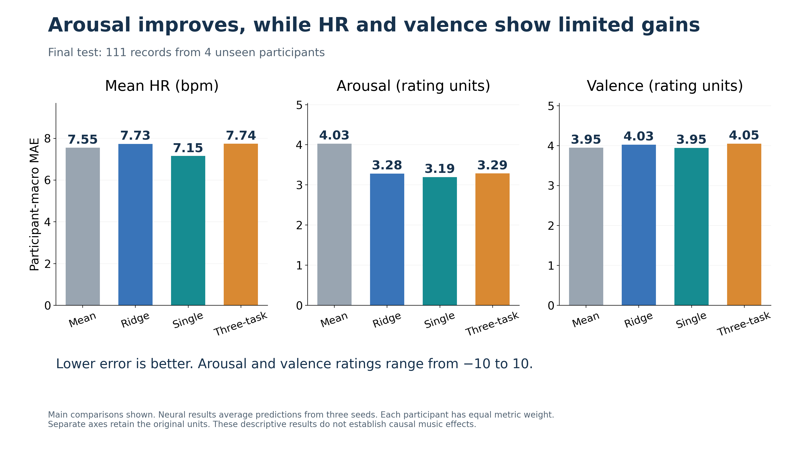

# Predicting Heart Rate and Emotional Responses to Music

A graduate research project using **HKU956** to compare single-task and multi-task learning from song audio. This repository contains the Python pipeline, tests, aggregate results, and a physiological-data audit. It does **not** redistribute participant recordings, song audio, author correspondence, credentials, or trained model pickles.

## Research question

Can whole-song acoustic features predict a listener's mean heart rate, arousal, and valence, and does joint prediction improve over separate models?

- Input: **37 whole-track acoustic features**, not verified reconstructions of the exact excerpt heard.
- Targets: mean HR in the **first 30 seconds after listening starts** (bpm), and post-listening arousal/valence ratings (−10 to +10).
- HR is a prediction target, not an input feature. Absolute HR is not a pre/post change score.
- Completed experiments use mean HR. No real-data RMSSD prediction model has been trained.

## Main findings

Arousal showed the most consistent improvement over the training-mean baseline. HR and valence improvements were limited or inconsistent. A shared three-task MLP did not show a stable advantage over separate networks.

| Model | Cross-validation HR MAE | Final-test HR MAE | Cross-validation arousal MAE | Final-test arousal MAE | Cross-validation valence MAE | Final-test valence MAE |
|---|---:|---:|---:|---:|---:|---:|
| Training mean | 9.9720 | 7.5528 | 3.6555 | 4.0274 | 3.4672 | 3.9472 |
| Ridge | 10.2074 | 7.7320 | 3.0708 | 3.2846 | 3.4704 | 4.0271 |
| Single-task MLP | 10.0440 | 7.1547 | 3.1689 | 3.1949 | 3.5310 | 3.9461 |
| Three-task MLP | 10.1878 | 7.7439 | 3.1088 | 3.2858 | 3.4912 | 4.0493 |

Lower is better. MAE is averaged equally across participants. HR uses bpm, while A/V use rating units. Neural scores average predictions from seeds 17, 42, and 93 before computing errors.



See [all model results](docs/results/model_comparison.csv), [methods and interpretation](docs/METHODS_AND_RESULTS.md), and [data quality findings](docs/DATA_QUALITY.md).

## Data and evaluation

HKU956 has 956 listening records from 30 participants and 592 distinct songs. We recovered 460 audio files, linked to 773 records. Requiring at least 30 seconds yields a 771-record model cohort.

| Partition | Participants | Records |
|---|---:|---:|
| Fixed training set | 22 | 538 |
| Fixed validation set | 4 | 122 |
| Held-out test set | 4 | 111 |
| Five-fold CV pool (training + validation participants) | 26 | 660 |

Cross-validation separates participants and uses an inner participant validation split. The final four participants do not enter CV. Songs may overlap across partitions, so this tests unseen listeners rather than unseen songs.

The final test was opened on **28 October 2026**. Later diagnostics are exploratory and do not turn this test into a fresh confirmation set.

## Quick start without the dataset

Python 3.10+ is declared by the package. The original experiments and release checks used Python 3.13. See `requirements.lock` for the historical environment snapshot, which is not a complete cross-platform lock.

```bash
python -m venv .venv
source .venv/bin/activate
python -m pip install -r requirements.txt
python -m pytest -q
```

Two integration tests skip when locally prepared real data are absent. Other tests exercise numerical, split, and quality-control logic using constructed inputs.

An optional **synthetic software check**, unrelated to real HKU956 findings:

```bash
python -m src.demo --generate-only  # creates synthetic inputs only
python -m src.demo                 # also trains and evaluates synthetic models
```

The demo writes only to `demo/` plus a generated `configs/demo.yaml`. Synthetic results must never be presented as real study evidence.

## Repository map

| Location | Contents |
|---|---|
| `src/` | Data adapters, features, regression models, training and evaluation |
| `scripts/` | Whole-track experiments, author-log alignment, quality audits and reports |
| `scripts/bcmi_feasibility/` | Separate alternative-dataset feasibility investigation |
| `configs/` | Relative-path research configurations |
| `tests/` | Software and numerical checks |
| `docs/` | Methods, data instructions, limitations and aggregate evidence |
| `docs/figures/` | Presentation-ready aggregate result figures |

For real data setup and historical experiment dependencies, read [reproducibility](docs/REPRODUCIBILITY.md). Historical reporting scripts require locally generated artifacts and are not all standalone entry points.

## Data access, attribution and reuse

- Dataset: [HKU956 repository](https://doi.org/10.25442/hku.21080821).
- Paper: Hu, X., Li, F., and Liu, R. (2022). *Detecting Music-Induced Emotion Based on Acoustic Analysis and Physiological Sensing: A Multimodal Approach*. Applied Sciences, 12(18), 9354. [DOI](https://doi.org/10.3390/app12189354).
- The dataset README specifies **CC BY-NC 4.0**. Audio has separate track-specific licensing and availability. Obtain data from its source and respect the applicable terms.
- Timestamped IBI and raw listening logs were supplied separately by the authors and are not rehosted here.
- No open-source license has been selected for this project's code yet. Public visibility is for review and does not itself grant an open-source license. See [reuse notes](docs/DATA_ACCESS_AND_REUSE.md).

## Current next steps

Clarify availability of continuous physiological recordings, the baseline mentioned in the paper, and playback-position logs. Consider a stronger-alignment subset only after checking signal coverage. Keep HRV exploratory and do not infer a causal music effect from prediction error or an observed within-window HR change.
