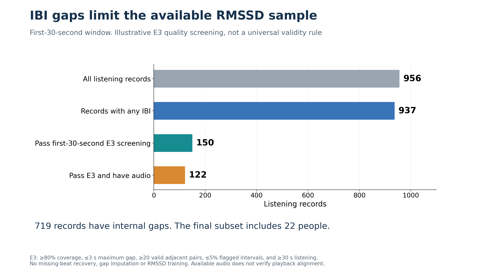

# Physiological data audit

The audit covers 956 listening records, 30 participants, raw HR/BVP/IBI and author-supplied timestamped IBI/logs. No HR-to-HRV conversion, long-gap imputation, or new model training was performed.

## IBI and exploratory RMSSD

- 33,313 timestamped IBI rows, 19 empty records.
- 719 records contain internal IBI discontinuities, totaling 1,551 gaps.
- All timestamped files reproduce the original IBI values. The later local folder comparison found all 956 CSV files byte-identical to the previously audited author archive.
- Median full-window candidate NN-support coverage is about 51.0% under the audit screening choices.
- Timestamps are interval-end times, supported by adjacent-time differences matching the subsequent IBI. A plausible value alone does not establish a valid adjacent NN pair.

The audit preserves original indices. It checks monotonicity, plausible interval range, containment in the listening window, timing adjacency, and abrupt relative changes. It flags both endpoints of abrupt changes only for genuinely adjacent intervals. Removed rows never create new adjacent pairs. Wrist PPG intervals are not ECG-verified normal sinus intervals.

The 1 November audit uses a 2 ms adjacency tolerance, a 300–2000 ms interval range, and 20% relative-change screening. The older `author_v2.yaml` encodes earlier rules including a different tolerance. These are separate historical policies, not interchangeable results.

| Window | E3 retained records | Participants | With audio | Participants with audio |
|---|---:|---:|---:|---:|
| Full listening window | 107 | 21 | 85 | 19 |
| First 30 seconds | 150 | 23 | 122 | 22 |

E3 requires coverage ≥80%, maximum unsupported gap ≤3 s, ≥20 valid consecutive pairs, flagged interval fraction ≤5%, and ≥30 s listening. These are exploratory engineering thresholds, not universal clinical criteria. Other policies are retained in [the threshold table](results/hrv_retention.csv). Historical counts of 171 under earlier rules do not represent the same policy.

Pooled differences from observed runs do not reconstruct a complete uninterrupted RMSSD window. Selected subsets may be biased and uneven across participants. Having audio does not prove exact exposure alignment.

## HR fallback

All 956 HR files contain finite values and the expected 1 Hz sample counts. At least 30 seconds leaves 954 records, including the 771 with recovered audio. Complete sample counts do not independently establish sensor accuracy or audio predictability.

## Playback alignment

The logs contain some `current ...s` media-position anchors. Timestamped IBI helps locate physiological events in wall-clock time but cannot recover missing media positions. Across 956 episodes: 785 are compatible with zero-start assumptions, 166 have partial/seek ambiguity, 4 have state conflicts, and 1 has consistent endpoints for all playing intervals without continuous observation. At the interval level, 178 playing segments have consistent two-endpoint evidence under a 1.5-second tolerance. These are candidates for further scrutiny, not fully verified continuous playback.

## BCMI-MIdAS feasibility branch

The separate Training (ds002724) and Calibration (ds002722) investigations found accessible ECG and audio, but unresolved stimulus mappings and short windows. Representative signal probes are not population-wide usable-label counts. This branch does not supply trained replacement models or justify merging the datasets automatically.
