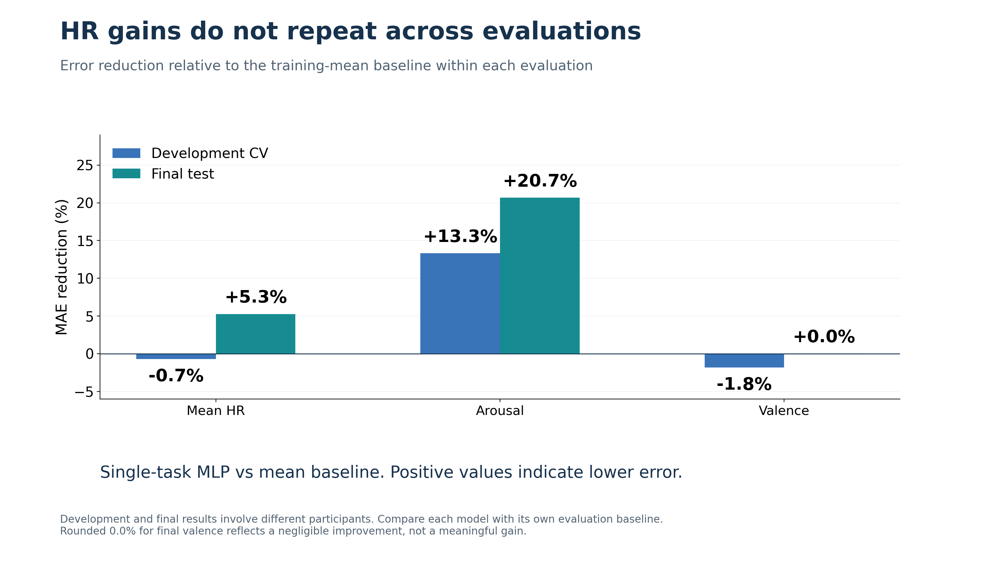

# Methods and results

## Question and gap

We test whether audio supplies information beyond a constant training-mean prediction, whether this generalizes to unseen listeners, and whether shared representations help across HR/arousal/valence. This is a prediction study, not a causal test of music effects.

## Features and models

The 37 acoustic features are 13 MFCC means and standard deviations (26), means and standard deviations of spectral centroid, bandwidth, rolloff, zero-crossing rate and RMS energy (10), and one tempo estimate. Whole-song summaries lose temporal order and do not explicitly model lyrics or personal baseline physiology.

The main models are a training-mean baseline, Ridge, separate single-hidden-layer ReLU MLPs, and one shared hidden layer with three outputs. Additional comparisons are a training-song-mean reference, an A/V-only MLP, and a capacity comparison whose selected parameter counts were not exactly matched.

Main MLP candidates use 16/32 hidden units, L2 0.001/0.01, full-batch Adam with learning rate 0.003, up to 500 epochs, patience 40, and minimum improvement 1e-5. Ridge candidates are 0.1, 1, 10, 100. Training-only transforms standardize features/targets. Joint loss weights standardized targets equally. Participant validation controls early stopping and selection. Configuration selection uses seed 17, then the fixed configuration also runs with seeds 42 and 93. Predictions receive equal seed weights. No test-selected seed.

The final evaluation uses the models fitted with the fixed training/validation split, with no merged train+validation refit. CV is a separate nested participant evaluation. Historical configurations that say `final_holdout_evaluation: false` preserve the pre-final-test stage; the later dedicated `final_holdout.py` protocol performed the authorized final evaluation. It is not an unopened test today.

## Findings

[Aggregate numerical evidence](results/model_comparison.csv) includes every evaluated family.

- Single-task arousal MAE improves by 13.3% in participant CV and 20.7% in the held-out test relative to the corresponding training-mean baseline.
- Single-task HR improves by 5.3% on the final test but is slightly worse in CV. Final HR R² remains negative. R² and participant-macro MAE have different references and weighting, so this is not a contradiction.
- Valence has little stable improvement from pure audio models.
- The ordinary shared three-task model's small CV arousal advantage over single-task does not persist in the final test.
- A song-mean reference depends on training labels for shared songs and is not a pure audio model.
- Four final participants are too few for strong significance claims. Repeated records and random seeds are not additional independent participants. Bootstrap intervals in local historical reports are descriptive.

## Post-hoc HR diagnostics

In the 771-record model cohort, 79.0% of the total HR sum of squares lies between participant means. This is a record-weighted descriptive decomposition, not causal attribution or an ICC. Personal song choices and contexts can contribute. Single-task predicted SD is about 28–29% of actual SD. After participant centering, predicted/actual correlation remains weak (CV 0.052, final 0.096). Participant differences do not explain all failure.

Within-participant pause/no-pause comparisons show an exploratory association with larger error, not a demonstrated causal effect. No test-label calibration or new model fitting was performed for these diagnostics.

## Limitations

Input is whole-track audio, HR covers the first 30 seconds of wall-clock listening, and A/V summarizes the listening episode. Nonzero playback starts and seeking complicate alignment. Current released chunks lack a usable pre-song baseline, although the paper explicitly mentions wearing the device early for stabilization and baseline acquisition. We cannot claim that baseline was never collected. Published A/V ratings have no per-song before/after pair. We have not established personalized music recommendation, intervention effects, or generalization to unseen songs.
